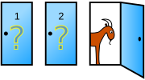

```{python}
import numpy as np
import pandas as pd
from scipy.stats import randint
import matplotlib.pyplot as plt
from IPython.core.display import HTML
```

## The Monty Hall Problem {.scrollable}
:::{style="font-size: .8em"}

Let's begin with one of the most famously unintuitive problems in probability: the **Monty Hall problem**. Some of you may have encountered it before.

:::{.center-text}

:::

What would you do:

- switch doors,
- stay with your initial choice, or
- assume it doesn't matter?

:::

## Learning Objectives
:::{style="font-size: .8em"}

- Obtaining more data
- Maximum a posteriori (MAP) estimator
- Application to the extended cookie problem

:::

## The Extended Cookie Problem
:::{style="font-size: .8em"}

Recall the cookie problem and suppose we are dealing with 101 bowls instead of 2. This time, bowl $i$ contains $i\%$ vanilla cookies and $(100-i)\%$ chocolate cookies.

- Bowl 0: all chocolate
- Bowl 1: 1% vanilla cookies and 99% chocolate
- Bowl 2: 2% vanilla cookies and 98% chocolate
- ...
- Bowl 100: all vanilla

__Question__: You choose a bowl at random, then draw a cookie at random and observe that it is vanilla. What is the probability that it came from bowl $i$?

:::

## Updating Distributions
:::{style="font-size: .8em"}

In the last lecture, we introduced the following Python function to perform the Bayesian update:

```{python}
#| echo: true
def update(table):
    table['unnorm. post.'] = table['prior'] * table['likelihood']
    prob_data = table['unnorm. post.'].sum()
    table['posterior'] = table['unnorm. post.'] / prob_data
    return table
```

This function computes the posterior by combining two columns in the Bayes table:

- the prior, and
- the likelihood.

:::

## Updating Distributions
:::{style="font-size: .8em"}

Recall that both the prior and posterior columns represent probability _**distributions**_ over the hypotheses. In other words, the update function takes one distribution (the prior), combines it with the likelihood of the observed data, and produces a new distribution (the posterior).

We will now rewrite the update function to make this observation explicit, focusing directly on distributions rather than on the table structure.

```{python}
#| echo: true
def update(distribution, likelihood):
    '''perform a Bayesian update on distribution using likelihood'''
    distribution['probs'] = distribution['probs'] * likelihood
    prob_data = distribution['probs'].sum()
    distribution['probs'] = distribution['probs'] / prob_data
    return distribution
```

:::

## The Extended Cookie Problem {.scrollable}
:::{style="font-size: .8em"}

In the new cookie problem, one of the 101 bowls is chosen at random, so we use a uniform prior distribution.

```{python}
#| echo: true
dist_101 = pd.DataFrame(index = np.arange(101))
dist_101['probs'] = randint(0, 101).pmf(np.arange(101))
```

```{python}
dist_101
```

:::

## The Extended Cookie Problem {.scrollable}
:::{style="font-size: .8em"}

The likelihood of drawing a vanilla cookie from each bowl is given by the bowl number:

```{python}
#| echo: true
likelihood_vanilla = np.arange(101)/100
```

```{python}
pd.DataFrame({'likelihood_vanilla': likelihood_vanilla})
```

:::

## The Extended Cookie Problem {.scrollable}
:::{style="font-size: .8em"}

We perform a Bayesian update using the new update function.

```{python}
priors = dist_101.copy()
```

```{python}
#| echo: true
update(dist_101, likelihood_vanilla)
```

:::

## The Extended Cookie Problem {.scrollable}
:::{style="font-size: .8em"}
The above table gives us the posterior distribution of probabilities across bowls. Let us compare the prior and the posterior distributions.

:::{.center-text}
```{python}
fig, ax = plt.subplots(figsize=(8, 4.5))
dist_101.plot(ax=ax, color='cornflowerblue', lw=4, fontsize=14)
priors.plot(ax=ax, color='gray', lw=4)
ax.legend(['Posteriors', 'Priors'], fontsize=14)
plt.xlabel('Bowl number', size=16)
plt.ylabel('Probability', size=16)
plt.show()
dist_101_1_update = dist_101.copy();
```
:::

<span style="color:rgb(1, 180, 180);">Why do both distributions look continuous?</span>
:::

## The Extended Cookie Problem
:::{style="font-size: .8em"}
The posterior probability increases with the bowl number, which is what we would expect since each higher bowl number has a higher percentage of vanilla cookies.

We can see that the probability we drew our cookie from Bowl 0 is exactly zero (it has no vanilla cookies), and the probability for Bowl 1 is very small—almost zero.

And the most likely bowl is Bowl 100, which makes sense since that bowl is 100% vanilla cookies.

<br>

_**What happens if we put the cookie back and draw another vanilla cookie out of the same bowl?**_

The answer is obtained by simply performing another Bayesian update.

:::

## The Extended Cookie Problem {.scrollable}
:::{style="font-size: .8em"}

```{python}
#| echo: true
update(dist_101, likelihood_vanilla);
```

:::{.center-text}
```{python}
fig, ax = plt.subplots(figsize=(8, 4.5))
dist_101.plot(ax = ax, color = 'cornflowerblue', lw = 4, fontsize = 14)
dist_101_1_update.plot(ax = ax, color = 'gray', lw = 4)
ax.legend(['Posteriors', 'Priors'], fontsize = 14)
plt.xlabel('Bowl number', size = 16)
plt.ylabel('Probability', size = 16)
dist_101_2_updates = dist_101.copy();
plt.show()
```
:::

Now the small-numbered bowls are even less likely, and the high-numbered bowls are even more likely.
:::

## The Extended Cookie Problem {.scrollable}
:::{style="font-size: .8em"}

Let's make things more interesting. _**What if we put the cookie back again and our next draw from that same bowl were a chocolate cookie?**_

```{python}
#| echo: true
likelihood_chocolate = 1 - likelihood_vanilla
update(dist_101, likelihood_chocolate);
```

:::{.center-text}
```{python}
fig, ax = plt.subplots(figsize=(8, 4.5))
dist_101.plot(ax = ax, color = 'cornflowerblue', lw = 4, fontsize = 14)
dist_101_2_updates.plot(ax = ax, color = 'gray', lw = 4)
ax.legend(['Posteriors', 'Priors'], fontsize = 14)
plt.xlabel('Bowl number', size = 16)
plt.ylabel('Probability', size = 16)
plt.show()
```
:::
:::

## The Extended Cookie Problem
:::{style="font-size: .8em"}
Now things look quite different!

Our bowl can't be bowl number 100 anymore because that one had no chocolate cookies at all. So we have zero probability for Bowl 100.

But it's still more likely to be a higher-numbered bowl, because we have drawn more vanilla cookies (two) than chocolate cookies (one).

<br><br>

The highest point in the posterior distribution is the _**most likely**_ bowl.

```{python}
#| echo: true
dist_101['probs'].idxmax()
```

Bowl 67 is the most likely bowl.
:::

## Maximum A Posteriori Estimator
:::{style="font-size: .8em"}

```{python}
def generate_html():
    return r"""
    <div class="purple-box">
     <span class="label">Maximum A Posteriori (MAP) Estimate</span>
        <p>
         The maximum a posteriori (MAP) estimate is the hypothesis that maximizes the posterior probability.
        </p>
    </div>
    """
html_content = generate_html()
display(HTML(html_content))
```

<br>

In our case, the MAP estimate is Bowl 67.

Notice that the maximum a posteriori bowl is the one that is closest to 2/3 vanilla and 1/3 chocolate. When we start from a uniform prior, the most likely bowl is the one whose cookie proportions most closely match our data.

:::

## The Extended Cookie Problem
:::{style="font-size: .8em"}

:::{.center-text}
```{python}
fig, ax = plt.subplots(figsize=(8, 4.5))
dist_101.plot(ax = ax, color = 'cornflowerblue', lw = 4, fontsize = 14)
ax.legend(['Posteriors'], fontsize = 14)
plt.xlabel('Bowl number', size = 16)
plt.ylabel('Probability', size = 16)
map_est = dist_101['probs'].idxmax()
ymin = dist_101['probs'].min()
ax.set_ylim(ymin = ymin)
plt.vlines(x = map_est, ymin = ymin, ymax = dist_101['probs'].max(), linestyles = 'dashed', color = 'g')
plt.plot(map_est, ymin, 'o', color = 'g', markersize = 14, clip_on = False)
plt.text(map_est+2, ymin+0.00015, r'MAP = 67', size = 16, ha = 'left', va = 'bottom')
plt.show()
```
:::

:::

## The Monty Hall Problem
:::{style="font-size: .8em"}

Now let's return to the Monty Hall Problem and use the MAP estimate to make an informed decision.

:::{.center-text}

:::

```{python}
def generate_html():
    return r"""
    <div class="blue-box">
        <p>
        What are the hypotheses in this problem?
        </p>
    </div>
    """
html_content = generate_html()
display(HTML(html_content))
```

:::

## The Monty Hall Problem {.scrollable}
:::{style="font-size: .8em"}

Each door starts with an equal prior probability of holding the prize:

```{python}
#| echo: true
table = pd.DataFrame()
table['hypothesis'] = ['Door 1', 'Door 2', 'Door 3']
table['prior'] = 1/3, 1/3, 1/3
```

```{python}
table.style.format({"prior": "{:.3f}"}).hide(axis="index")
```

What is our _**data**_ in this scenario?

Without loss of generality, suppose we originally selected door 1. Now Monty opens a door (let's say door 3, again without loss of generality) to reveal a gag prize. So the door that is open gives us the data.

And what is the _**likelihood**_ of the data under each hypothesis?
:::

## The Monty Hall Problem
:::{style="font-size: .8em"}

**Hypothesis 1:** The prize is behind door 1

In this case Monty chose door 2 or door 3 at random, so he was equally likely to open door 2 or door 3, so the observation that he opened door 3 had a 50/50 chance of occurring.

**Hypothesis 2:** The prize is behind door 2

In this case Monty _**must**_ open door 3, so the observation that he opened door 3 was guaranteed to happen.

**Hypothesis 3:** The prize is behind door 3

Monty could not have opened a door with the prize behind it, so the probability of seeing him open door 3 under this hypothesis is 0.

:::

## The Monty Hall Problem {.scrollable}
:::{style="font-size: .8em"}

```{python}
#| echo: true
table['likelihood'] = 1/2, 1, 0
```

```{python}
table.style.format({"prior": "{:.3f}", "likelihood": "{:.2f}"}).hide(axis="index")
```

Now let's find the posterior probabilities.

```{python}
# The Bayes table here uses the table version of update from earlier in the lecture
def update(table):
    table['unnorm. post.'] = table['prior'] * table['likelihood']
    prob_data = table['unnorm. post.'].sum()
    table['posterior'] = table['unnorm. post.'] / prob_data
    return table
```

```{python}
#| echo: true
update(table)
table.style.format({"prior": "{:.3f}", "likelihood": "{:.2f}", "unnorm. post.": "{:.3f}", "posterior": "{:.3f}"}).hide(axis="index")
```

Turns out there is a 2/3 probability the prize is behind door 2! We should switch doors.
:::

## Group Question 1
:::{style="font-size: .8em"}

```{python}
def generate_html():
    return r"""
    <div class="blue-box">
        <p>
        Suppose we have a box with a 6-sided die, an 8-sided die, and a 12-sided die. We choose one of the dice at random, roll it, and report that the outcome is a 1.<br>
        a. Make a Bayes table to compute the posterior probabilities for each die.
        <br>
        <br>
        <br>
        <br>
        <br>
        <br>
        <br>
        b. Find the MAP estimate of the die type.
        <br>
        <br>
        </p>
    </div>
    """
html_content = generate_html()
display(HTML(html_content))
```

:::
